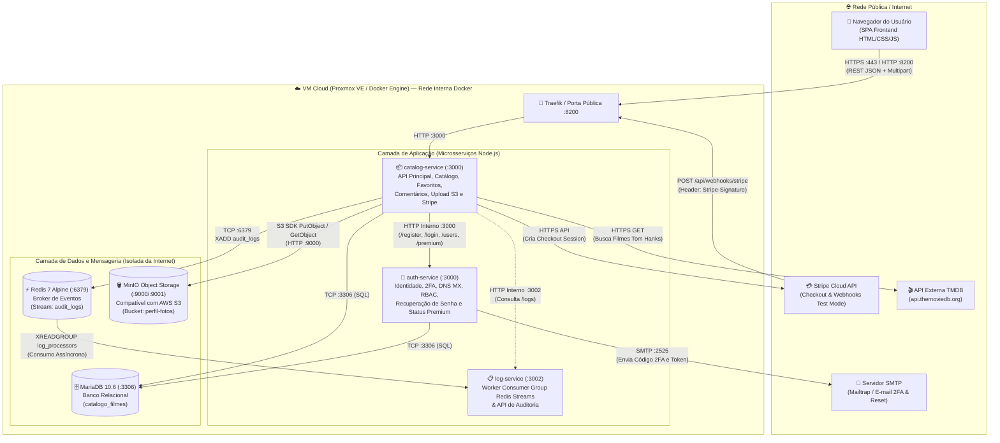
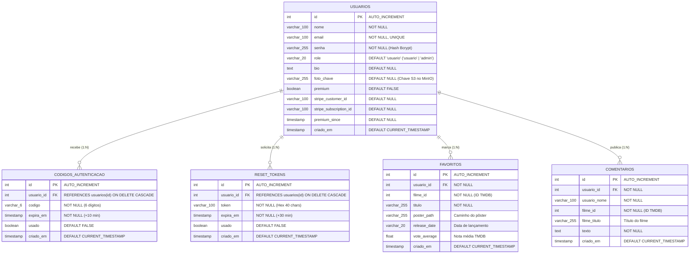

# 📘 Documentação Técnica Reversa — Catálogo Tom Hanks (Cloud Microservices)

> **Disciplina:** ISW055 · Introdução à Computação em Nuvem  
> **Professor:** Prof. Allan Lincoln Rodrigues Siriani ([@siriani](https://github.com/siriani))  
> **Aluna:** Amabili Flor  
> **URL de Produção:** [https://amabili-flor-isw055.lapps.studio/](https://amabili-flor-isw055.lapps.studio/)  
> **Repositório:** [https://github.com/glaffamabili/catalogo-tom-hanks](https://github.com/glaffamabili/catalogo-tom-hanks)

---

## 1. Especificação Funcional (O que o sistema faz)

Esta especificação reversa descreve o comportamento real do sistema construído ao longo das Atividades 1 a 7, sob o ponto de vista dos usuários finais (`usuario`, `usuario premium` e `admin`), sem depender do conhecimento prévio do código-fonte.

### 1.1. Cadastro, Autenticação Multifator (2FA) e Recuperação de Senha
- **Cadastro com Validação de Domínio (DNS MX):** Qualquer visitante pode criar uma conta informando nome, e-mail e senha. O sistema valida sintaticamente o endereço e realiza uma consulta DNS real pelos registros `MX` do domínio informado antes de persistir o cadastro.
- **Login em Duas Etapas (2FA por E-mail):** Ao informar e-mail e senha válidos, o usuário não entra diretamente no sistema. O servidor gera um código numérico aleatório de 6 dígitos com validade de 10 minutos e o envia por SMTP (Mailtrap/Nodemailer). O acesso à sessão autenticada só é liberado após a confirmação desse código.
- **Recuperação de Senha via Token Temporário:** Caso esqueça a senha, o usuário solicita a redefinição informando seu e-mail. Um token criptográfico hexadecimal (`crypto.randomBytes`) válido por 30 minutos é enviado por e-mail; ao utilizá-lo na tela de redefinição, a senha é atualizada com novo hash `bcrypt` e o token é invalidado.

### 1.2. Catálogo de Filmes, Favoritos e Comunidade
- **Exploração do Catálogo:** Usuários autenticados visualizam a filmografia de Tom Hanks sincronizada sob demanda com a API externa do **TMDB** (`The Movie Database`), exibindo pôster, título, ano de lançamento, nota média e sinopse em português.
- **Gestão de Favoritos com Diferenciação de Plano:** O usuário pode adicionar e remover filmes da sua lista pessoal de favoritos. Usuários do plano gratuito possuem limite estrito de até **3 filmes favoritos**, enquanto assinantes **Premium** possuem favoritos ilimitados.
- **Avaliações e Comentários:** Usuários autenticados podem publicar comentários associados a qualquer filme do catálogo e excluir seus próprios comentários.

### 1.3. Perfil do Usuário e Armazenamento de Objetos (S3/MinIO)
- **Edição de Dados Cadastrais:** O usuário pode atualizar seu nome de exibição e sua biografia pessoal diretamente na aba "Meu Perfil".
- **Upload de Foto de Perfil:** O usuário pode enviar uma imagem (`PNG`, `JPG`, `JPEG` ou `WEBP` de até `5 MB`). O arquivo binário nunca é salvo no banco relacional: ele é armazenado no Object Storage **MinIO** (compatível com Amazon S3), enquanto o MariaDB guarda apenas a chave/caminho do objeto (`foto_chave`).

### 1.4. Assinatura Premium e Pagamentos com Stripe (Modo de Teste)
- **Checkout Hospedado (PCI-DSS Compliance):** O usuário pode assinar o **Plano Premium (R$ 9,90/mês)** clicando em "Assinar Plano Premium". O backend cria uma `Checkout Session` no **Stripe** (em modo de teste) e redireciona o usuário para a página segura de pagamento. Nenhum dado sensível de cartão (PAN, CVV ou validade) transita ou é armazenado no banco de dados da aplicação.
- **Confirmação Assíncrona via Webhook:** Após a conclusão do pagamento no Stripe, o provedor envia um evento HTTP `POST /api/webhooks/stripe` assinado criptograficamente (`Stripe-Signature`). O sistema valida a assinatura HMAC-SHA256 e promove automaticamente a conta do usuário para `premium = true`, ativando o selo `👑 PREMIUM` no perfil e liberando favoritos ilimitados.

### 1.5. Administração, Moderação (RBAC) e Auditoria Assíncrona
- **Painel Administrativo Restrito:** Usuários com papel `admin` possuem acesso exclusivo à listagem completa de contas cadastradas, podendo alternar papéis (`usuario` ↔ `admin`) e auditar eventos recentes.
- **Moderação de Conteúdo:** Administradores podem remover comentários de qualquer usuário em qualquer filme; tentativas de exclusão de comentários de terceiros por usuários comuns são bloqueadas no backend com `HTTP 403 Forbidden`.
- **Trilha de Auditoria em Tempo Real (Event Streaming):** Todas as ações críticas (login, falha de login, cadastro, upload de foto, moderação, checkout e confirmação de webhook Stripe) são publicadas de forma assíncrona em uma stream do **Redis (`XADD`)** e consumidas pelo microsserviço `log-service` via Consumer Group (`XREADGROUP`).

---

## 2. Arquitetura do Sistema

O sistema adota uma arquitetura de microsserviços conteinerizados em **Docker**, orquestrados via **Docker Compose** e gerenciados em produção pelo **Portainer** sobre uma máquina virtual Linux no cluster **Proxmox VE**.

### 2.1. Diagrama de Arquitetura e Fluxo de Comunicação

### 2.2. Inventário de Serviços e Exposição de Rede

| Serviço / Componente | Tecnologia / Imagem | Porta Interna | Exposição Pública | Papel na Arquitetura |
| :--- | :--- | :---: | :---: | :--- |
| **`catalog-service`** | Node.js 18 + Express | `3000` | ✅ Sim (`:8200` / HTTPS) | Gateway da aplicação, serve o frontend, gerencia favoritos, comentários, uploads pro MinIO, checkout/webhook do Stripe e proxy de autenticação. |
| **`auth-service`** | Node.js 18 + Express | `3000` | ❌ Não (Somente rede interna) | Microsserviço de identidade: cadastro com validação MX, login com 2FA, hash `bcrypt`, recuperação de senha, RBAC e controle do status Premium. |
| **`log-service`** | Node.js 18 + ioredis | `3002` | ❌ Não (Somente rede interna) | Consumidor assíncrono de eventos de negócio via Redis Streams (`XREADGROUP`) e retenção dos últimos 500 eventos auditados em memória. |
| **`mariadb`** | `mariadb:10.6` | `3306` | ❌ Não (Isolado) | Persistência relacional transacional (usuários, códigos 2FA, tokens de reset, favoritos e comentários). |
| **`redis`** | `redis:7-alpine` | `6379` | ❌ Não (Isolado) | Broker de mensageria assíncrona estruturado em Redis Streams (`audit_logs`) com persistência AOF (`--appendonly yes`). |
| **`minio`** | `minio/minio:latest` | `9000` / `9001` | ❌ API interna (`:9000`) | Armazenamento de objetos compatível com S3 para fotos de perfil dos usuários no bucket `perfil-fotos`. |
| **Stripe API** | SaaS Externo (Test Mode) | HTTPS (`443`) | 🌐 Nuvem Pública | Processamento seguro de pagamentos, hospedagem do Checkout e envio de notificações assíncronas via Webhook assinado. |
| **TMDB API** | SaaS Externo | HTTPS (`443`) | 🌐 Nuvem Pública | Provedor externo de metadados e pôsteres dos filmes de Tom Hanks. |

---

## 3. Regras de Negócio Extraídas do Código

Abaixo estão listadas todas as regras de negócio implementadas e verificadas diretamente no código de `auth-service/server.js`, `catalog-service/server.js` e `log-service/server.js`, expressas no formato declarativo **"Se X, então Y"**:

### 3.1. Identidade, Cadastro e Segurança (Auth Service)
1. **RN01 — Obrigatoriedade de Campos no Cadastro:** **Se** uma requisição `POST /register` não contiver `nome`, `email` ou `senha`, **então** o sistema rejeita a operação com `HTTP 400 Bad Request`.
2. **RN02 — Validação de Formato e Domínio de E-mail (DNS MX):** **Se** o e-mail informado no cadastro não respeitar o formato padrão ou o seu domínio não possuir registros `MX` válidos no DNS, **então** o sistema bloqueia o cadastro com `HTTP 400` (`"O domínio do email não existe ou não pode receber mensagens"`).
3. **RN03 — Unicidade de E-mail:** **Se** o e-mail já estiver cadastrado na tabela `usuarios`, **então** o sistema impede a duplicidade retornando `HTTP 400` (`"Este email já está cadastrado"`).
4. **RN04 — Hash Criptográfico de Senha:** **Se** um usuário é cadastrado ou redefine sua senha, **então** a senha em texto puro nunca é persistida, sendo transformada em hash `bcrypt` com custo (`saltRounds`) igual a `10`.
5. **RN05 — Papel Inicial Padrão:** **Se** um usuário se cadastra sem especificar papel (ou especificando qualquer valor diferente de `'admin'`), **então** o sistema atribui automaticamente o papel `'usuario'` e o plano gratuito (`premium = FALSE`).
6. **RN06 — Exigência de Segundo Fator (2FA) no Login:** **Se** o usuário informa e-mail e senha corretos em `POST /login`, **então** o sistema **não** inicia a sessão imediatamente; ele invalida códigos anteriores daquele usuário, gera um código de 6 dígitos com expiração de **10 minutos** na tabela `codigos_autenticacao`, dispara o envio por SMTP e retorna `requires2FA: true`.
7. **RN07 — Validação e Uso Único do Código 2FA:** **Se** o código informado em `POST /verify-2fa` não existir, já tiver sido utilizado (`usado = TRUE`) ou estiver expirado (`expira_em <= NOW()`), **então** o sistema nega o acesso com `HTTP 401` (`"Código inválido ou expirado"`). Caso seja válido, marca `usado = TRUE` e retorna o perfil autenticado do usuário.
8. **RN08 — Expiração de Token de Recuperação de Senha:** **Se** o usuário solicita recuperação em `POST /forgot-password`, **então** os tokens anteriores são invalidados e um novo token hexadecimal de 40 caracteres é gerado com validade estrita de **30 minutos** (`DATE_ADD(NOW(), INTERVAL 30 MINUTE)`).

### 3.2. Autorização por Papel — RBAC (Auth & Catalog Service)
9. **RN09 — Restrição do Painel de Usuários:** **Se** um usuário autenticado cujo papel na tabela `usuarios` não seja `'admin'` chamar `GET /api/users` ou `PATCH /api/users/:id/role`, **então** o backend bloqueia a requisição com `HTTP 403 Forbidden` e registra o evento `ACESSO_NEGADO_403` no Redis Stream.
10. **RN10 — Proteção contra Auto-Rebaixamento de Admin:** **Se** um administrador tentar remover seu próprio papel de `admin` (`adminId === targetUserId && role !== 'admin'`), **então** o sistema bloqueia a operação com `HTTP 400` (`"Você não pode remover seu próprio privilégio de admin"`).
11. **RN11 — Moderação e Exclusão de Comentários:** **Se** um usuário tentar excluir um comentário (`DELETE /api/comments/:id`) que **não** é de sua autoria (`comentario.usuario_id !== userId`) e o seu papel **não** for `'admin'`, **então** o sistema recusa a exclusão com `HTTP 403 Forbidden` e publica um evento de auditoria `ACESSO_NEGADO_403` no Redis Stream.

### 3.3. Perfil e Armazenamento de Objetos (MinIO)
12. **RN12 — Validação de Tipo e Tamanho de Imagem no Upload:** **Se** o arquivo enviado em `POST /api/profile/:userId/photo` não for dos tipos `image/png`, `image/jpeg`, `image/jpg` ou `image/webp`, **então** o upload é rejeitado com `HTTP 400`. **Se** o arquivo ultrapassar **5 MB** (`5 * 1024 * 1024 bytes`), **então** o Multer interrompe o upload e retorna `HTTP 400` (`"A imagem excede o limite máximo de 5MB"`).
13. **RN13 — Separação entre Binário e Metadado:** **Se** o upload da foto de perfil é bem-sucedido, **então** o binário é gravado exclusivamente no bucket `perfil-fotos` do MinIO sob a chave `user-{id}/avatar-{timestamp}.{ext}`, e somente a string da chave (`foto_chave`) é salva na tabela `usuarios` do MariaDB.

### 3.4. Monetização, Plano Premium e Stripe
14. **RN14 — Limite do Plano Gratuito vs. Benefício Premium:** **Se** um usuário possui `premium = FALSE` e já tem **3 filmes** cadastrados na tabela `favoritos`, **então** qualquer nova tentativa em `POST /api/favorites` é bloqueada com `HTTP 403 Forbidden` (`code: "PREMIUM_REQUIRED"`), orientando-o a assinar o Plano Premium. **Se** o usuário possui `premium = TRUE`, **então** a adição de novos favoritos é ilimitada.
15. **RN15 — Isolamento de Dados de Cartão (PCI Compliance):** **Se** um usuário inicia o checkout em `POST /api/checkout/create-session`, **então** o backend cria apenas uma sessão de pagamento e redireciona o navegador; em nenhuma hipótese números de cartão, CVV ou data de validade são recebidos ou salvos no banco de dados (que armazena apenas `stripe_customer_id` e `stripe_subscription_id`).
16. **RN16 — Validação Criptográfica Obrigatória de Webhook:** **Se** uma requisição chegar em `POST /api/webhooks/stripe` sem o cabeçalho `Stripe-Signature` ou com uma assinatura HMAC-SHA256 divergente do `STRIPE_WEBHOOK_SECRET`, **então** o sistema rejeita imediatamente a chamada com `HTTP 400` (`"Webhook Error: Assinatura inválida"`), registrando `STRIPE_WEBHOOK_ASSINATURA_INVALIDA` no log e não alterando nenhum dado no banco.
17. **RN17 — Ativação Assíncrona do Status Premium:** **Se** o webhook com assinatura válida contiver o evento `checkout.session.completed` (ou `invoice.paid`) com `payment_status = 'paid'`, **então** o sistema atualiza o registro do usuário no MariaDB para `premium = TRUE`, preenche `stripe_customer_id`, `stripe_subscription_id` e `premium_since = NOW()`, e publica o evento `STRIPE_WEBHOOK_PAGAMENTO_CONFIRMADO` no Redis Stream.

---

## 4. Modelo de Dados

O armazenamento do sistema é distribuído em três tecnologias complementares, cada uma escolhida de acordo com a natureza do dado:
1. **MariaDB (`catalogo_filmes`):** Dados estruturados e relacionais com integridade referencial.
2. **MinIO (`perfil-fotos`):** Objetos binários não estruturados (imagens de avatar).
3. **Redis Streams (`audit_logs`):** Fluxo append-only de eventos de auditoria em tempo real.

### 4.1. Diagrama Entidade-Relacionamento (DER — MariaDB)

### 4.2. Detalhamento das Tabelas Relacionais (MariaDB)

| Tabela | Chave Primária | Chaves Estrangeiras / Restrições | Finalidade no Sistema |
| :--- | :--- | :--- | :--- |
| **`usuarios`** | `id` (`INT`) | `UNIQUE (email)` | Armazena credenciais (hash `bcrypt`), papel RBAC (`role`), metadados de perfil (`bio`, `foto_chave` do MinIO) e vínculo de assinatura Stripe (`premium`, `stripe_customer_id`, `stripe_subscription_id`). |
| **`codigos_autenticacao`** | `id` (`INT`) | `usuario_id` → `usuarios(id)` (`ON DELETE CASCADE`) | Armazena os códigos OTP de 6 dígitos enviados por e-mail para o segundo fator de autenticação (2FA), com controle de expiração e flag de uso único. |
| **`reset_tokens`** | `id` (`INT`) | `usuario_id` → `usuarios(id)` (`ON DELETE CASCADE`) | Guarda os tokens temporários de 30 minutos para redefinição segura de senha esquecida. |
| **`favoritos`** | `id` (`INT`) | `UNIQUE KEY unique_fav (usuario_id, filme_id)` | Relaciona usuários aos filmes favoritados do catálogo (limitado a 3 registros para contas gratuitas e ilimitado para contas `premium = TRUE`). |
| **`comentarios`** | `id` (`INT`) | `usuario_id` (referência lógica ao autor) | Armazena as avaliações e comentários públicos feitos pelos usuários nos filmes, sujeitos à moderação RBAC pelo papel `admin`. |

### 4.3. Estruturas Não-Relacionais (Redis Streams e MinIO S3)

- **Stream `audit_logs` (Redis 7):**
  - **Grupo de Consumidores:** `log_processors` (consumidor `worker_1` no `log-service`).
  - **Campos de cada entrada (`XADD`):**
    - `event`: Tipo do evento (`LOGIN_SUCESSO`, `LOGIN_FALHA`, `USUARIO_CADASTRADO`, `FAVORITO_ADICIONADO`, `COMENTARIO_CRIADO`, `COMENTARIO_MODERADO`, `FOTO_PERFIL_ATUALIZADA`, `STRIPE_CHECKOUT_CRIADO`, `STRIPE_WEBHOOK_PAGAMENTO_CONFIRMADO`, `ACESSO_NEGADO_403`, etc.).
    - `userId`: ID do usuário autor ou alvo da ação.
    - `role`: Papel do usuário no momento da ação (`usuario` ou `admin`).
    - `timestamp`: Data/hora em formato ISO 8601.
    - `details`: Objeto JSON serializado contendo metadados específicos da operação (IP, `movieId`, `sessionId`, `stripeCustomerId`, `sizeBytes`, etc.).
- **Bucket `perfil-fotos` (MinIO Object Storage):**
  - **Padrão de Chave (`Object Key`):** `user-{userId}/avatar-{timestamp}.{ext}` (ex: `user-1/avatar-1760029000.png`).
  - **Metadados HTTP:** `Content-Type` preservado conforme o MIME type validado no upload (`image/png`, `image/jpeg`, `image/webp`).
